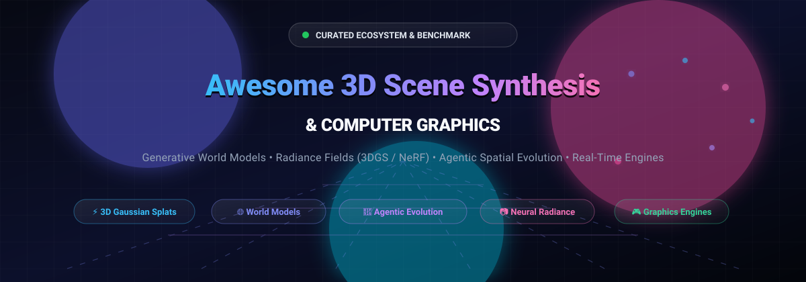

  

# 🌐 Awesome 3D Scene Synthesis & Computer Graphics 🎮

### *Curated Ecosystem of Generative 3D Worlds, Radiance Fields (3DGS / NeRF), Agentic Layouts, and Real-Time Graphics Engines*

  
  
  
  
  
  

  <strong>A comprehensive, production-grade guide to state-of-the-art Spatial AI, 3D Scene Synthesis models, Gaussian Splatting editors, and open-source Computer Graphics runtimes.</strong>

---

## 📑 Table of Contents
- [📌 Sector Overview & Market Dynamics](#-sector-overview--market-dynamics)
- [💼 SaaS & Hosted Platforms](#-saas--hosted-platforms)
- [💻 Open-Source GitHub Projects](#-open-source-github-projects)
- [🤝 How to Contribute](#-how-to-contribute)
- [⭐ Star History](#-star-history)
- [💖 Support](#-support)
- [⚖️ Disclaimer](#️-disclaimer)

---

## 📌 Sector Overview & Market Dynamics

The global computer graphics software and AI 3D generation market represents an estimated total addressable market of **$160B–$195B** (with the dedicated generative AI 3D scene synthesis sub-segment growing at a 28%+ CAGR to over **$3.2B**). The ecosystem exhibits a **dual market structure**: it is **highly fragmented** at the application layer—where specialized startups, neural reconstruction apps, and modular multi-object synthesis pipelines compete fiercely—yet **concentrated** at the foundational GPU compute and core simulation platform layer (dominated by hyperscalers, NVIDIA hardware, and industry-standard runtimes like Unreal Engine, Unity, and Blender).

---

## 💼 SaaS & Hosted Platforms

A market-sorted overview of commercial cloud platforms providing 3D scene generation, volumetric Gaussian Splatting capture, photogrammetry, and spatial intelligence hosting. Ranked by company scale (valuation / funding / revenue descending).

| Platform | Valuation / Company Scale | Starting Pricing | Free Tier Limits | Key Capabilities & Highlights |
| :--- | :--- | :--- | :--- | :--- |
| **[Niantic Scaniverse](https://scaniverse.com)** | **$9.0B Valuation** (Spun out via Niantic Spatial; parent gaming unit sold for $3.5B) | **$20/mo** ($200/yr for Plus Plan) | **Free forever plan**: Unlimited on-device 3D/Gaussian Splatting captures & exports (`.spz`, `.ply`, `.glb`), plus **20,000 monthly cloud processing credits** | On-device 3D Gaussian Splatting, LiDAR scanning, and geospatial cloud meshing without mandatory uploads. |
| **[World Labs (Marble)](https://worldlabs.ai)** | **$8.2B Acquisition Valuation** (Agreed acquisition by AMD; $1B+ raised, founded by Fei-Fei Li) | **$20/mo** (Standard plan; Pro at $35/mo) | **Free forever plan**: **4 world generations/month** (introductory testing quota); viewer exploration enabled; exports & commercial rights locked to paid tiers | Spatial intelligence large world model (LWM) generating explorable, 3D-consistent persistent environments from single images or text prompts. |
| **[Luma AI](https://lumalabs.ai)** | **$4.0B Valuation** ($900M Series C; ~$80M ARR) | **$30/mo** (Plus plan, 10,000 credits/mo; $25/mo billed annually) | **Free forever plan**: **~1 generation/day** (limited rolling daily allotment subject to strict compute throttling; no credit rollover) | Interactive 3D Gaussian Splatting capture, Flythrough generation, Dream Machine video/world creation, and WebGL viewer embedding. |
| **[Spline](https://spline.design)** | **$32M+ Funding** (~$5.0M ARR; Series A backed by Gradient Ventures) | **$9/mo** (Hobby plan billed annually; $12/mo billed monthly) | **Free forever plan**: **Unlimited personal files & public viewer exports**; includes Spline logo watermark; AI generation features & team workspaces locked | Collaborative browser-based 3D scene designer supporting interactive 3D Gaussian Splat imports, real-time physics, and zero-install WebGL embeds. |
| **[Artec Cloud](https://artec3d.com)** | **$27.8M ARR** (Privately held; €15M EIB venture debt backed) | **$70/mo** (200 GB Plan; $59/mo billed annually) | **Free forever plan**: **5 GB cloud storage** with viewer collaboration and annotation tools; processing quotas require paid tier | Cloud-native 3D point cloud alignment, industrial inspection, and automated mesh reconstruction for precision photogrammetry. |
| **[Polycam](https://poly.cam)** | **$22M+ Funding** (~$6.5M ARR; Series A led by Left Lane & Adjacent) | **$17.99/mo** ($99.99/yr for Pro; Business at $33/mo) | **Free forever plan**: **Unlimited web/LiDAR viewing & standard `.gltf` export**; photogrammetry capture limited to non-commercial testing; pro mesh exports (`.obj`, `.fbx`, `.ply`) require upgrade | Mobile & web 3D Gaussian Splatting capture, drone photogrammetry, building floor plans, and spatial asset library. |
| **[KIRI Engine](https://kiriengine.app)** | **Hundreds of Millions RMB Funding** (Series A backed by Huawei Hubble & 37 Interactive) | **$6.66/mo** ($79.99/yr for Pro; $14.99/mo monthly) | **Free forever plan**: **Unlimited photo scans & exports** (OBJ, FBX, STL, GLTF) up to **150 photos per scan** (4K texture limit; 3DGS & quad-retopology require Pro) | Multi-platform photogrammetry and cloud 3D Gaussian Splatting with neural surface reconstruction and Blender bridge. |
| **[Gracia AI](https://gracia.ai)** | **$2.9M Seed Funding** (Deep-tech startup backed by The VR Fund & EWOR) | **Developer Pilot Invoicing** (Enterprise pilot plans) | **Free Developer Trial**: Available upon request / pilot onboarding; non-commercial community viewer app free on Meta Quest / Steam | 4D Gaussian Splatting runtime and streaming infrastructure built for 6DoF volumetric video on VR headsets and web browsers. |
| **[Jawset Postshot](https://jawset.com)** | **Boutique Visual Computing Studio** (Privately held; creators of TurbulenceFD) | **€17/mo** (€204/yr for Indie; €26/mo monthly; Studio €39/mo) | **Free forever plan**: **Unlimited local training & rendering** up to 4K SDR resolution; watermarked renders; `.ply`/`.spz` exports locked; strictly non-commercial | Real-time workstation radiance field trainer and 3DGS editor with native Unreal Engine and Adobe After Effects integrations. |

---

## 💻 Open-Source GitHub Projects

Curated open-source frameworks for agentic 3D layout generation, single-image scene reconstruction, neural radiance fields (3DGS / NeRF), and foundational computer graphics engines. **Ranked strictly by GitHub Star Count (Descending)**.

| Repository | GitHub Stars | License | Primary Category | Description |
| :--- | :--- | :--- | :--- | :--- |
| **[godotengine/godot](https://github.com/godotengine/godot)** |  | `MIT` | Real-Time Engine | Multi-platform 2D and 3D computer graphics game engine featuring Vulkan-based physical rendering, node architecture, and procedural world composition. |
| **[mrdoob/three.js](https://github.com/mrdoob/three.js)** |  | `MIT` | WebGL / WebGPU Runtime | Standard JavaScript 3D library powering browser-native scene synthesis, Gaussian Splat viewers, PBR shaders, and XR environments. |
| **[BabylonJS/Babylon.js](https://github.com/BabylonJS/Babylon.js)** |  | `Apache-2.0` | Real-Time Graphics | Powerful, beautiful, and simple WebGPU/WebGL 3D rendering engine for interactive web graphics, physics simulations, and scene graphs. |
| **[graphdeco-inria/gaussian-splatting](https://github.com/graphdeco-inria/gaussian-splatting)** |  | `Custom (Research)` | Radiance Fields (3DGS) | Reference SIGGRAPH 2023 CUDA implementation for real-time 3D radiance field synthesis, rasterization, and interactive SIBR scene rendering. |
| **[blender/blender](https://github.com/blender/blender)** |  | `GPL-2.0+` | 3D Graphics Suite | Foundational 3D creation suite powering procedural scene synthesis via Geometry Nodes, Cycles ray tracing, and EEVEE real-time rendering. |
| **[Tencent/Hunyuan3D-2](https://github.com/Tencent/Hunyuan3D-2)** |  | `Tencent Hunyuan` | Generative 3D Synthesis | High-resolution generative 3D asset and compositional environment foundation model synthesizing high-fidelity textured 3D meshes from text/images. |
| **[microsoft/TRELLIS](https://github.com/microsoft/TRELLIS)** |  | `MIT` | Generative 3D Asset/Scene | Structured latent 3D representation model generating production-quality textured meshes and radiance fields for complex scene placement pipelines. |
| **[openai/shap-e](https://github.com/openai/shap-e)** |  | `MIT` | Generative 3D Diffusion | OpenAI's conditional diffusion framework generating 3D implicit functions, radiance fields, and textured polygon meshes from text and images. |
| **[nerfstudio-project/nerfstudio](https://github.com/nerfstudio-project/nerfstudio)** |  | `Apache-2.0` | Modular Neural Rendering | Collaborative PyTorch framework uniting 3D Gaussian Splatting (`splatfacto`), NeRF architectures, COLMAP/GLOMAP camera pipelines, and interactive web visualizers. |
| **[playcanvas/supersplat](https://github.com/playcanvas/supersplat)** |  | `MIT` | 3DGS Editor / Optimizer | Free web-based 3D Gaussian Splatting tool for inspecting, cropping, bounding-box editing, floater cleaning, and compressing `.ply` and `.sog` scenes. |
| **[ashawkey/stable-dreamfusion](https://github.com/ashawkey/stable-dreamfusion)** |  | `Apache-2.0` | Score Distillation (SDS) | PyTorch implementation of text-to-3D DreamFusion using 2D Stable Diffusion priors, NeRFs, and 3D Gaussian Splatting rasterization. |
| **[princeton-vl/infinigen](https://github.com/princeton-vl/infinigen)** |  | `BSD-3-Clause` | Procedural World Generator | Princeton VL procedural 3D world and indoor scene generator built upon Blender Geometry Nodes to create infinite photorealistic synthetic environments. |
| **[VAST-AI-Research/TripoSR](https://github.com/VAST-AI-Research/TripoSR)** |  | `MIT` | Feed-Forward 3D Meshing | Ultra-fast feed-forward 3D reconstruction model generating complete 3D meshes from a single image in under 0.5 seconds for instant scene population. |
| **[threestudio-project/threestudio](https://github.com/threestudio-project/threestudio)** |  | `Apache-2.0` | Generative 3D Studio | Unified modular PyTorch studio for 3D content creation from text prompts, single images, and few-shot multiview inputs using diffusion guidance. |
| **[nerfstudio-project/gsplat](https://github.com/nerfstudio-project/gsplat)** |  | `Apache-2.0` | CUDA Rasterization Core | Open-source CUDA library with PyTorch bindings for highly accelerated, differentiable 3D Gaussian Splatting rasterization and camera pose estimation. |
| **[ArthurBrussee/brush](https://github.com/ArthurBrussee/brush)** |  | `Apache-2.0` | Universal 3DGS Engine | Cross-platform 3D Gaussian Splatting training and rendering suite built in Rust with Burn and WebGPU—running across NVIDIA, AMD, Apple Silicon, and web. |
| **[MrNeRF/LichtFeld-Studio](https://github.com/MrNeRF/LichtFeld-Studio)** |  | `GPL-3.0` | Native 3DGS Studio | High-performance C++/CUDA desktop application for real-time 3D Gaussian Splatting training, deep editing, color grading, and point-cloud transformations. |
| **[wgsxm/PartCrafter](https://github.com/wgsxm/PartCrafter)** |  | `Apache-2.0` | Compositional 3D Parts | Shape-conditioned generative part synthesis producing fine-grained, decomposable 3D elements for compositional scene generation. |
| **[hzxie/Awesome-3D-Scene-Generation](https://github.com/hzxie/Awesome-3D-Scene-Generation)** |  | `CC0-1.0` | Research Index | Curated academic repository tracking research papers, datasets, and methods in 3D indoor and outdoor scene generation. |
| **[VAST-AI-Research/MIDI-3D](https://github.com/VAST-AI-Research/MIDI-3D)** |  | `Apache-2.0` | Multi-Instance Diffusion | Multi-instance diffusion framework generating compositional 3D scenes from a single image with spatially aligned, collision-free object geometry. |
| **[cgtuebingen/3D-RE-GEN](https://github.com/cgtuebingen/3D-RE-GEN)** |  | `MIT` | Scene Reconstruction | Single-image indoor scene reconstruction combining Grounded-SAM, generative inpainting, single-object 3D synthesis, and room-layout optimization. |
| **[allenai/Holodeck](https://github.com/allenai/Holodeck)** |  | `Apache-2.0` | Embodied AI Worlds | Language-guided 3D indoor environment generator utilizing LLMs and Objaverse assets to produce simulation-ready, physically grounded environments. |
| **[chenguolin/InstructScene](https://github.com/chenguolin/InstructScene)** |  | `MIT` | Instruction 3D Layout | ICLR 2024 instruction-driven 3D indoor scene synthesis model pairing semantic graph priors with a layout diffusion decoder. |
| **[YandanYang/Awesome-Indoor-Scene-Synthesis](https://github.com/YandanYang/Awesome-Indoor-Scene-Synthesis)** |  | `MIT` | Research Index | Curated paper collection focusing specifically on indoor layout generation, spatial reasoning graphs, and room synthesis. |
| **[rxjfighting/SceneMosaic](https://github.com/rxjfighting/SceneMosaic)** |  | `Apache-2.0` | Agentic Layout Evolution | Turns single indoor photos into simulation-ready `.glb` scenes via promptable segmentation (`SAM3`), 3D object synthesis, and VLM local unit evolution. |
| **[rxjfighting/DirectLayout](https://github.com/rxjfighting/DirectLayout)** |  | `MIT` | Spatial Numerical Layout | Direct numerical layout generation and bounding box regression framework for controllable 3D indoor scene composition. |

---

## 🤝 How to Contribute

We welcome contributions from graphics engineers, spatial AI researchers, and 3D developers! 🚀

1. 🍴 **Fork the repository** to your GitHub account.
2. 🌿 **Create a descriptive feature branch** (`git checkout -b add-my-awesome-tool`).
3. 📝 **Add your tool or repository**:
   - For SaaS: Add to the SaaS table including valuation/scale, starting price, and specific free tier limits.
   - For Open-Source: Add to the Open-Source table including the social star badge (`style=social&color=white`) linking to its stargazers page.
4. 💾 **Commit your changes** (`git commit -m "feat: add my-awesome-tool"`).
5. 🚀 **Push to your branch** (`git push origin add-my-awesome-tool`).
6. 📬 **Submit a Pull Request** with a brief summary of the project and why it belongs in this ecosystem.

---

## ⭐ Star History

---

## 💖 Support

Thank you for exploring and using this ecosystem guide! 🌟

If this repository helped you in your research, spatial AI pipeline, or computer graphics development, please consider:
- ⭐ **Starring this repository** to help others discover it.
- 🍴 **Forking and sharing** it with your fellow engineers and researchers.
- ☕ **Buying a coffee or sponsoring** future development through the [Sponsor Dashboard](https://github.com/sponsors/ishandutta2007).

---

## ⚖️ Disclaimer

- This is an open **community-curated** educational and professional resource—inclusion does not constitute commercial endorsement.
- Generative 3D scene synthesis pipelines and multi-instance diffusion models frequently require high-VRAM workstation GPUs (24GB–48GB+ VRAM) and authorized access to model weights.
- Always review individual software, dataset, and model licenses (`MIT`, `Apache-2.0`, `BSD-3-Clause`, `GPL-2.0+`, or research-only terms) before utilizing assets in commercial or production environments.

---

  Maintained with ❤️ by the open-source Computer Graphics & Spatial AI community.

